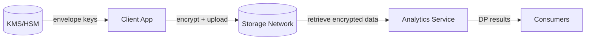

# Architecture Overview

This project explores a privacy-preserving AI architecture. It combines client-side encryption, distributed storage, and privacy-preserving analytics.

## Components

- Data producers/clients: Prepare and encrypt data client-side
- Storage network: Distributed DB (e.g., Cassandra) or content-addressed storage (e.g., IPFS)
- Key management: External KMS/HSM for envelope encryption (conceptual)
- Analytics service: Performs differentially private queries/calculations
- Research modules: QKD simulation and holographic memory demo

## Data flow (concept)



## DP query sequence (concept)

```mermaid
sequenceDiagram
  participant C as Client
  participant S as Storage
  participant P as Analytics
  participant K as KMS

  C->>S: Upload ciphertext (AEAD)
  C->>K: Request DEK wrapped with KEK
  Note over C,S: Metadata minimized; access logs recorded
  P->>S: Request encrypted data subset
  P->>K: Access to unwrap DEK (policy-gated)
  P->>P: Compute with DP mechanism (epsilon budget)
  P-->>C: Return DP result (no raw data exposure)
```

Assumptions and concrete security controls are detailed in `THREAT_MODEL.md` and `SECURITY.md`.